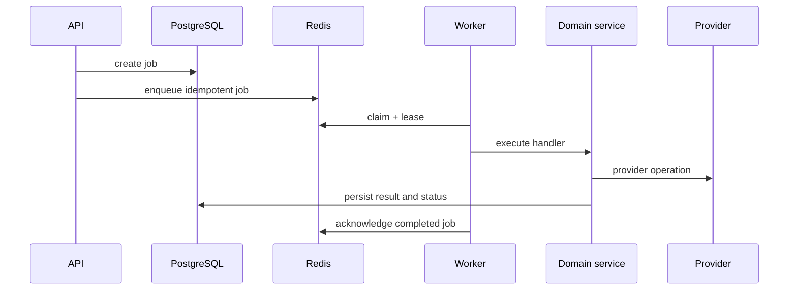

# Jobs

The API creates idempotent operation jobs and exposes workspace-scoped status through `/api/jobs/:id`. Local mode uses `InMemoryJobQueue`; production uses `RedisJobQueue` with ioredis, bounded retries, claims, and stale recovery. PostgreSQL `AppJob` provides the durable application record; Redis is the execution transport.

When PostgreSQL and Redis are configured, API dispatch first creates the workspace-scoped `AppJob`, then enqueues the same job ID into Redis. The worker updates the Prisma record on claim, completion, retry, and failure. Without those services, development deliberately uses the synchronous/in-memory path and reports that mode in health.

