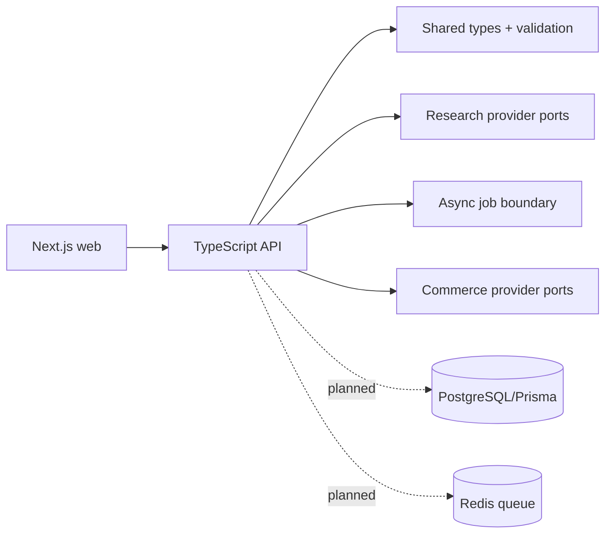

# System architecture

The MVP keeps the API and web separable, uses ports for research/AI/image processing/commerce, and uses an in-memory store only for local development. PostgreSQL, Redis, object storage, authentication, and workers are planned integration points rather than fake implementations.
